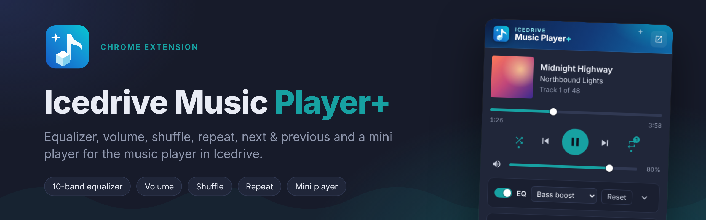
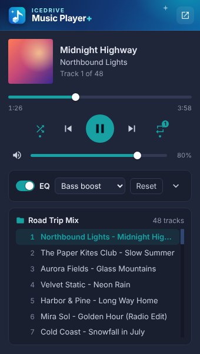
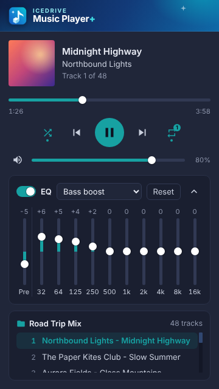
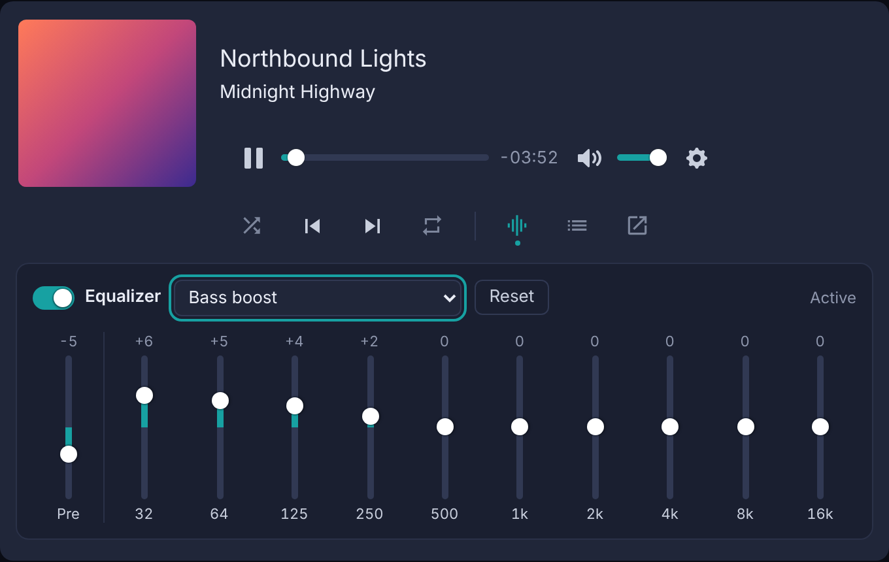

<p align="center">
  
</p>

<p align="center">
  
  
  
  
  <a href="LICENSE"></a>
</p>

**Icedrive Music Player+** is a browser extension that turns the basic audio preview in [Icedrive](https://icedrive.net) into a proper music player. Open a folder of songs, press play, and get a queue, next and previous track, shuffle, repeat, media keys and a mini player window.

> This is an unofficial, community-made extension. It isn't affiliated with or endorsed by Icedrive.

## Features

- **Now playing.** Title, artist, album art, and the position of the track in the folder.
- **Seek bar.** Scrub anywhere in the track from the popup.
- **Queue.** Every audio file in the open folder, in Icedrive's sort order, under the folder's name. Click one to play it.
- **Auto-advance.** The next track starts when the current one ends.
- **Shuffle.** Each track plays once per round, and *Previous* goes back to the track you actually heard.
- **Repeat.** Off, whole folder, or a single track. Shuffle and repeat settings are remembered.
- **Equalizer.** 10 bands (32 Hz to 16 kHz), a preamp and 17 presets (bass boost, vocal, rock, podcast, laptop speakers and more), with a limiter so boosts don't distort. Shared by all Icedrive tabs and remembered.
- **Volume.** Volume slider and mute in the popup and mini player, in sync with Icedrive's own volume slider.
- **Everything inside Icedrive.** Under Icedrive's own player: shuffle, previous, next and repeat, the full equalizer, the folder's track list and a button for the mini player. You don't need to open the popup at all.
- **Mini player.** Pop the player out into a small window that stays open while you work elsewhere.
- **Media keys.** Play/pause, next and previous on your keyboard or headphones. Track info and artwork show up in the browser's media panel and in the Windows/macOS media overlay.
- **Keyboard shortcuts** that work from any tab, and can be made global.

## Screenshots

<table>
  <tr>
    <td align="center" width="50%">
      <br>
      <sub><b>Popup</b>: now playing, seek bar, shuffle and repeat, queue</sub>
    </td>
    <td align="center" width="50%">
      <br>
      <sub><b>Mini player</b>: the popup as its own window, with a taller queue</sub>
    </td>
  </tr>
  <tr>
    <td align="center" colspan="2">
      <br>
      <sub><b>Inside Icedrive</b>: controls, equalizer and track list under the built-in player</sub>
    </td>
  </tr>
</table>

## Installation

The extension isn't in the Chrome Web Store yet, so for now it's installed from source.

**Requirements:** Node.js 20 or newer, and Chrome, Brave or another Chromium-based browser.

```bash
git clone https://github.com/D3jwis/icedrive-music-extension.git
cd icedrive-music-extension
npm install
npm run build
```

1. Open `chrome://extensions` (in Brave, `brave://extensions`).
2. Turn on **Developer mode**.
3. Click **Load unpacked** and select the `.output/chrome-mv3` folder.
4. Reload your Icedrive tab.

## Usage

1. Open a folder with music on [icedrive.net](https://icedrive.net) and play any song.
2. Use the controls that now appear under Icedrive's player, or click the extension icon for the popup.
   The equalizer button (the bars icon) opens the equalizer, the list icon shows the folder's tracks.
3. Click **↗** in the corner of the popup to open the mini player window. Clicking it again focuses the window that's already open.

### Equalizer

Turn it on with the switch, then pick a preset or drag the bands. Lower the **Pre** (preamp) slider when you boost a lot, so loud songs stay clean. The popup and mini player have the same equalizer: click the arrow next to *Reset* to unfold all bands.

Icedrive streams songs from its download servers. To run them through the equalizer, the extension asks the browser to load the song in CORS mode, which restarts it at the same spot once (a split second). If Icedrive's server ever refuses that for a file, the song just plays as before without the equalizer, and the panel says so.

### Keyboard shortcuts

| Shortcut | Action |
| --- | --- |
| `Alt+Shift+Space` | Play / pause |
| `Alt+Shift+.` | Next track |
| `Alt+Shift+,` | Previous track |
| `Alt+Shift+S` | Toggle shuffle |

Change them at `chrome://extensions/shortcuts` (`brave://extensions/shortcuts`). You can also set them to **Global** there so they work when the browser is in the background. In the popup, `Space` toggles play/pause.

Your keyboard's media keys work without any setup while Icedrive is playing.

## Privacy

The extension only runs on `icedrive.net` and only asks for the `storage` permission, which it uses to remember your shuffle and repeat settings. It has no analytics, sends nothing to any server, and doesn't touch your Icedrive login or files. Everything happens inside your own Icedrive tab.

## Security and work computers

The extension loads no remote code and enforces a strict Content Security Policy, and every build is checked by `npm run check:security`, which fails on any new permission, weaker CSP or unsafe code pattern. See [SECURITY.md](SECURITY.md) for details and how to report a vulnerability, and [docs/enterprise-install.md](docs/enterprise-install.md) for installing on a managed (company) laptop and what to send your IT team.

## Known limitations

- Music only plays while Icedrive's preview window is open. Closing the preview stops playback, which is how Icedrive itself works.
- The queue is the audio files in the folder that's currently open.
- If Icedrive changes its page layout, the extension may need an update. All Icedrive-specific selectors live in [`lib/icedrive-dom.ts`](lib/icedrive-dom.ts).

### How it works

Icedrive plays audio in a preview overlay (`#preview`) built on [Plyr](https://plyr.io). The extension reads that player's state and drives it.

## License

[MIT](LICENSE) © 2026 D3jwis
